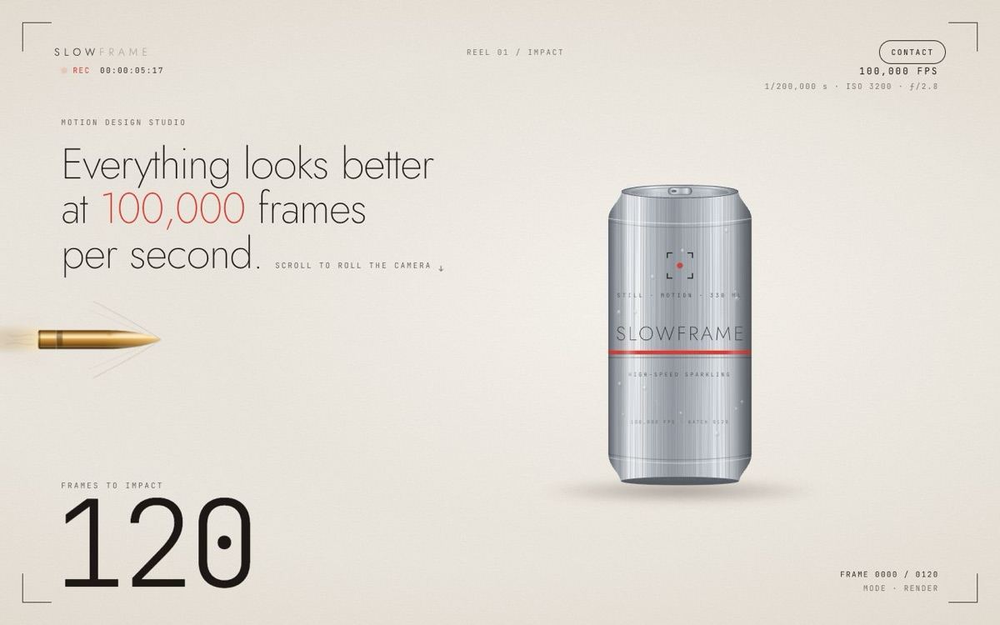

# SLOWFRAME — Motion Design Studio

[](https://tabishhassan5121472.github.io/slowframe-studio/)


A landing page told as one scroll-driven high-speed-camera shot: a brass bullet crawls toward a brushed-aluminium can at 100,000 FPS, turns into a blueprint, hits, and the clip shrinks into a social feed.

**Live demo:** [https://tabishhassan5121472.github.io/slowframe-studio/](https://tabishhassan5121472.github.io/slowframe-studio/)

## Techniques
- Pinned (`position: sticky`) 1100vh scene; every element is a pure function of smoothed scroll progress, so it scrubs both ways
- Hand-built SVG illustrations: multi-stop metallic gradients, `feTurbulence` brushed-metal texture, condensation beads, Mach-cone lines
- Wireframe/blueprint mode with non-scaling-stroke line drawings and live measurement annotations
- Canvas 2D particle burst (droplets, aluminium shards, mist) using analytic ballistic motion with drag and gravity, so it stays scrubbable; slow-motion time ramp
- Can tears along a jagged `clip-path`; real-time screen shake and flash at impact
- `clip-path: inset()` camera pull into a CSS phone mockup with feed UI
- GSAP 3.12.5 + ScrollTrigger letter-by-letter wordmark reveal
- Viewfinder HUD: REC timecode, frame counter 120 → 000, mode readout
- Respects `prefers-reduced-motion`; DPR capped at 2; render loop pauses offscreen

Plain HTML/CSS/JS, no build step.


## Run locally

```bash
npx serve .
```

## License

MIT — free to learn from and reuse.
